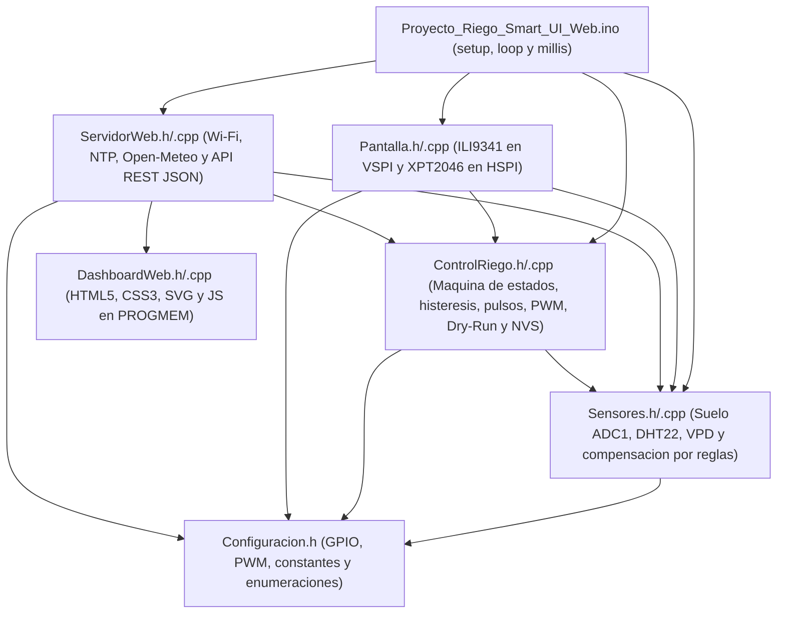

# Guía de Estudio y Defensa: Sistema de riego automático

**Subtítulo:** Sistema de control y supervisión mediante ESP32  
**Asignatura:** Sistemas Digitales — Ingeniería en Sistemas y Computación  
**Institución:** Universidad Tecnológica de El Salvador (UTEC)  
**Docente:** Ing. José Mauricio Rivera Mejía  

---

## 1. Objetivo Académico y Organización Modular del Código

El proyecto desarrolla un sistema digital embebido de control automático mediante un microcontrolador **ESP32 DevKit V1** capaz de adquirir señales analógicas y digitales, regular en lazo cerrado el suministro de agua por pulsos mediante **PWM (`5000 Hz`)** y etapa de potencia **MOSFET `LR7843`**, y ofrecer supervisión sincronizada en pantalla táctil local y servidor web en red LAN.

Para facilitar su estudio, mantenimiento y defensa por los seis integrantes, el firmware está dividido en módulos C/C++ con responsabilidades únicas y sin duplicación de variables:

---

## 2. Componentes de Hardware y Conexionado Definitivo ([Configuracion.h](file:///c:/Users/gerri/Documents/Arduino/Proyecto_Riego_Smart_UI_Web/src/modulos/Configuracion.h))

| Componente | Pines en el ESP32 | Módulo C/C++ y función |
| :--- | :--- | :--- |
| **ESP32 DevKit V1 (30 pines)** | Unidad central de control | Todos los módulos (`ADC1`, `LEDC PWM`, `VSPI`/`HSPI`, `WiFi`, `NVS`). |
| **Sensor capacitivo de suelo v2.0** | `GPIO 34` (`ADC1_CH6`), `3.3V`, `GND` | [Sensores.cpp](file:///c:/Users/gerri/Documents/Arduino/Proyecto_Riego_Smart_UI_Web/src/modulos/Sensores.cpp) · Transductor analógico con respuesta inversa en tensión. |
| **Sensor ambiental `DHT22`** | `GPIO 13`, `3.3V`, `GND` | [Sensores.cpp](file:///c:/Users/gerri/Documents/Arduino/Proyecto_Riego_Smart_UI_Web/src/modulos/Sensores.cpp) · Trama digital de 40 bits de temperatura y humedad relativa. |
| **Pantalla TFT `ILI9341` (`320×240`)** | `CS=5`, `DC=22`, `RST=17`, `LED=21`, `MOSI=23`, `MISO=19`, `SCK=18` (`VSPI`) | [Pantalla.cpp](file:///c:/Users/gerri/Documents/Arduino/Proyecto_Riego_Smart_UI_Web/src/modulos/Pantalla.cpp) · Visualización `RGB565` directa en memoria `GRAM`. |
| **Panel táctil `XPT2046`** | `CLK=32`, `CS=33`, `DIN=25`, `DO=26`, `IRQ=27` (`HSPI`) | [Pantalla.cpp](file:///c:/Users/gerri/Documents/Arduino/Proyecto_Riego_Smart_UI_Web/src/modulos/Pantalla.cpp) · Lectura de presión y coordenadas `(X, Y)` en bus separado. |
| **Módulo MOSFET `LR7843` + `PC817`** | `PWM = GPIO 4`, `GND` lógico, `+5V` y `GND` potencia | [ControlRiego.cpp](file:///c:/Users/gerri/Documents/Arduino/Proyecto_Riego_Smart_UI_Web/src/modulos/ControlRiego.cpp) · Aislamiento óptico y conmutación *Low-Side*. |
| **Microbomba sumergible DC `5V` + diodo** | Terminales `Load` y `+5V` del MOSFET | [ControlRiego.cpp](file:///c:/Users/gerri/Documents/Arduino/Proyecto_Riego_Smart_UI_Web/src/modulos/ControlRiego.cpp) · Bombeo de agua; el diodo *Flyback* absorbe picos inductivos. |

---

## 3. Adquisición de Sensores y Compensación por Reglas ([Sensores.h](file:///c:/Users/gerri/Documents/Arduino/Proyecto_Riego_Smart_UI_Web/src/modulos/Sensores.h) / [Sensores.cpp](file:///c:/Users/gerri/Documents/Arduino/Proyecto_Riego_Smart_UI_Web/src/modulos/Sensores.cpp))

1. **Sensor capacitivo y conversión `ADC1` (`leerSensorSuelo()`):**
   - Usa `GPIO 34` (`ADC1_CH6` a 12 bits `0..4095` y atenuación `11 dB`) porque `ADC2` queda bloqueado en el ESP32 cuando opera el Wi-Fi.
   - Promedia 8 muestras; si sale del rango eléctrico (`750..3850`) o la dispersión supera `350` cuentas en **2 ciclos seguidos**, declara fallo (`humedadSueloValida = false`); exige **3 lecturas válidas consecutivas** para recuperarse.
   - Interpolación lineal inversa entre `SOIL_DRY_ADC = 3050` y `SOIL_WET_ADC = 1350` con filtro `70/30`:
     $$H\% = \frac{3050 - ADC_{leido}}{3050 - 1350} \times 100$$
     Representa un **índice relativo calibrado del sustrato**, no contenido volumétrico gravimétrico de laboratorio.

2. **Sensor `DHT22`, `VPD` e Índice de Calor (`leerSensorDHT22()` y `calcularParametrosAmbientales()`):**
   - Se interroga cada `2500 ms` (`>= 2 s`), conservando los estados `Operativo`, `Valor inusual` y `Sin respuesta` (tras `3` fallos o `10 s` sin trama fresca; requiere `2` lecturas válidas seguidas para recuperarse). Validar la trama digital confirma una **última lectura válida recibida**, sin sustituir una calibración experimental frente a instrumento patrón.
   - **Ecuación de Tetens (`VPD` en `kPa`):**
     $$VP_{sat} = 0.61078 \cdot \exp\left(\frac{17.27 \cdot T}{T + 237.3}\right), \qquad VPD = VP_{sat} \cdot \left(1 - \frac{HR}{100}\right)$$
   - **Índice de calor (Rothfusz):** aplicable únicamente cuando $T \ge 27\text{ °C}$ y $HR \ge 40\%$.

3. **Sistema Adaptativo de Compensación Climática basado en reglas (`calcularCompensacionClimatica()`):**
   - Evalúa seis reglas deterministas: térmica (`+9%` / `-7%`), `VPD` (`+6%` / `-6%`) y `Open-Meteo` vigente (`-5%` por lluvia `WMO >= 51`, o `+3%` por *«Condiciones de cielo despejado durante el día»* con `WMO <= 1 && is_day == 1`, sin afirmar medición directa de radiación solar).
   - Distingue entre `deltaClimaCalculadoPct` (suma directa de reglas) y `deltaClimaPct = umbralDinamicoInf - umbralBasePct` (compensación efectivamente aplicada tras acotar el umbral con `constrain(..., 20, 75)`). La humedad del sustrato es siempre la variable gobernante.

---

## 4. Control Hidráulico, PWM y Protecciones ([ControlRiego.h](file:///c:/Users/gerri/Documents/Arduino/Proyecto_Riego_Smart_UI_Web/src/modulos/ControlRiego.h) / [ControlRiego.cpp](file:///c:/Users/gerri/Documents/Arduino/Proyecto_Riego_Smart_UI_Web/src/modulos/ControlRiego.cpp))

1. **Modulación PWM (`5000 Hz`) y *Soft Start* (`cambiarEstadoBomba()`):**
   - El canal `LEDC 1` (`GPIO 4`) conmuta el módulo `MOSFET LR7843` (`PC817` + `IRLR7843`). Al encender, aplica una rampa desde `90` hasta `potenciaBombaPWM` (`165`, `215` o `255`) cada `10 ms` para reducir el pico inductivo de corriente sobre la fuente de `5 V`.

2. **Máquina de 4 estados, histéresis y pulsos (`actualizarControlAutomatico()`):**
   - **Histéresis:** inicia riego cuando `humedadSueloPct < U_inf` y finaliza cuando `humedadSueloPct >= U_sup` ($U_{sup} = U_{inf} + H$).
   - **Riego por pulsos:** alterna **`6 s` de bombeo activo** (`ESTADO_RIEGO`) con **`10 s` de pausa pasiva** (`ESTADO_INFILTRACION`) para permitir la percolación del agua antes de reevaluar el suelo.

3. **Separación entre `Dry-Run` acumulado (`20 s`) y límite continuo (`25 s`) (`supervisarSeguridadHidraulica()`):**
   - **`tiempoAcumuladoBombeoMs` (`Dry-Run` máx. `20 s`):** suma únicamente los segundos efectivos con bomba encendida a través de los pulsos (`6 s + 6 s + 6 s + 2 s = 20 s`), **sin reiniciarse durante las pausas de `10 s`**. Solo vuelve a `0` si el sustrato sube al menos **`+2%`**. Si alcanza `20 s` sin respuesta, dispara `ALERTA_ANOMALIA_RIEGO`.
   - **`tiempoContinuoBombaMs` (máx. `25 s`):** mide una sola activación ininterrumpida sin pausas; corta con `ALERTA_TIEMPO_MAXIMO` a los `25 s` seguidos incluso si la humedad sí aumentó.
   - **`tiempoBombeoCicloTotalMs` (máx. `60 s`):** tope global preventivo por ciclo.

4. **Centralización absoluta y rearme verificado (`puedeActivarBomba()`, `conmutarBombaManual()`, `establecerModoOperacion()`, `rearmarAlertaPorUsuario()`):**
   - Tanto `Pantalla.cpp` como `ServidorWeb.cpp` invocan exactamente estas mismas funciones: ninguna interfaz duplica lógica ni puede omitir protecciones.
   - `rearmarAlertaPorUsuario()` fuerza `PWM = 0`, comprueba lecturas válidas consecutivas en `GPIO 34` y, si el fallo persiste, mantiene `ESTADO_ALERTA` devolviendo mensaje explicativo (`HTTP 409` en Web).

5. **Persistencia `NVS` (`cargarConfiguracionNVS()` / `guardarConfiguracionNVS()`):**
   - Almacena parámetros en la partición Flash `"riego_utec"` escribiendo solo ante cambios reales para evitar desgaste de memoria.

---

## 5. Interfaces Gráficas y Comunicaciones ([Pantalla.cpp](file:///c:/Users/gerri/Documents/Arduino/Proyecto_Riego_Smart_UI_Web/src/modulos/Pantalla.cpp), [DashboardWeb.cpp](file:///c:/Users/gerri/Documents/Arduino/Proyecto_Riego_Smart_UI_Web/src/modulos/DashboardWeb.cpp) y [ServidorWeb.cpp](file:///c:/Users/gerri/Documents/Arduino/Proyecto_Riego_Smart_UI_Web/src/modulos/ServidorWeb.cpp))

- **Pantalla TFT y táctil (`Pantalla.cpp`):** buses `VSPI` (`ILI9341`) y `HSPI` (`XPT2046`) separados, renderizado sin parpadeo sobre `GRAM` (`0 KB` de *framebuffer* en RAM) y reinicio en caliente por `GPIO 17`.
- **Dashboard Web separado en `PROGMEM` (`DashboardWeb.cpp`):** contiene todo el HTML, CSS *responsive*, SVG y JavaScript fuera de la lógica Arduino, servido en `GET /` sin CDNs ni dependencias externas.
- **Conectividad y `Open-Meteo` (`ServidorWeb.cpp`):** el control y la supervisión local (TFT y Dashboard Web en LAN) siguen funcionando sin Internet; `Open-Meteo` sí requiere conectividad externa, configura `setConnectTimeout(1500)` y `setTimeout(1500)` sobre `WiFiClient` (sin asumir bloqueo rígido absoluto ante DNS lento) y queda inhibido mediante `cicloHidraulicoEnCurso()` durante cualquier riego o pausa de infiltración.
- **Filtro de API local (`solicitudControlAutorizada()`):** verifica IP privada `RFC 1918` y cabecera `X-Control-Local: ESP32` como barrera básica contra *CSRF* accidental en LAN (no autenticación criptográfica).

---

## 6. Distribución Modular de Estudio para los 6 Integrantes

| Integrante | Tema de defensa | Archivos específicos asignados |
| :--- | :--- | :--- |
| **1. Kevin Ernesto Cortez Cañas** | **Arquitectura del ESP32, organización modular y multitarea con `millis()`** | [Proyecto_Riego_Smart_UI_Web.ino](file:///c:/Users/gerri/Documents/Arduino/Proyecto_Riego_Smart_UI_Web/Proyecto_Riego_Smart_UI_Web.ino) y [Configuracion.h](file:///c:/Users/gerri/Documents/Arduino/Proyecto_Riego_Smart_UI_Web/src/modulos/Configuracion.h) |
| **2. Osaki Vladimir Hernández Arevalo** | **Sensor capacitivo, conversión `ADC1` de 12 bits, curva inversa y detección de fallos** | [Sensores.h](file:///c:/Users/gerri/Documents/Arduino/Proyecto_Riego_Smart_UI_Web/src/modulos/Sensores.h) y [Sensores.cpp](file:///c:/Users/gerri/Documents/Arduino/Proyecto_Riego_Smart_UI_Web/src/modulos/Sensores.cpp) (`leerSensorSuelo`) |
| **3. Diego Enrique Hernandez Molina** | **Protocolo `DHT22`, `VPD` de Tetens y compensación climática (calculada vs. efectiva)** | [Sensores.cpp](file:///c:/Users/gerri/Documents/Arduino/Proyecto_Riego_Smart_UI_Web/src/modulos/Sensores.cpp) (`leerSensorDHT22`, `calcularCompensacionClimatica`) |
| **4. José Adonay López García** | **Electrónica de potencia (`MOSFET LR7843`), `PWM` a `5000 Hz`, *Soft Start* y memoria `NVS`** | [ControlRiego.cpp](file:///c:/Users/gerri/Documents/Arduino/Proyecto_Riego_Smart_UI_Web/src/modulos/ControlRiego.cpp) (`inicializarControlRiego`, `cambiarEstadoBomba`, `NVS`) |
| **5. Gerardo David Martínez Salmerón** | **Máquina de 4 estados, histéresis, pulsos de infiltración y seguridad `Dry-Run`** | [ControlRiego.cpp](file:///c:/Users/gerri/Documents/Arduino/Proyecto_Riego_Smart_UI_Web/src/modulos/ControlRiego.cpp) (`actualizarControlAutomatico`, `supervisarSeguridadHidraulica`, `rearmarAlertaPorUsuario`) |
| **6. Jonathan Alexander Mejía Martínez** | **Pantalla TFT (`VSPI`/`HSPI`), Dashboard Web en `PROGMEM` y servidor API REST local** | [Pantalla.cpp](file:///c:/Users/gerri/Documents/Arduino/Proyecto_Riego_Smart_UI_Web/src/modulos/Pantalla.cpp), [DashboardWeb.cpp](file:///c:/Users/gerri/Documents/Arduino/Proyecto_Riego_Smart_UI_Web/src/modulos/DashboardWeb.cpp) y [ServidorWeb.cpp](file:///c:/Users/gerri/Documents/Arduino/Proyecto_Riego_Smart_UI_Web/src/modulos/ServidorWeb.cpp) |

---

## 7. Preguntas Frecuentes de Defensa y Respuestas Claras

1. **¿Por qué separaron el proyecto en archivos `.h` y `.cpp` en lugar de varios `.ino`?**  
   Porque Arduino concatena automáticamente múltiples `.ino` sin control explícito de encabezados, lo que suele causar errores de prototipos y variables globales acopladas. Usar módulos `.h` y `.cpp` estándar de C++ delimita las responsabilidades, evita dependencias circulares y permite modificar el Dashboard Web (`DashboardWeb.cpp`) o el control hidráulico (`ControlRiego.cpp`) de forma independiente.

2. **¿Cómo garantizan que ni la pantalla TFT ni el Dashboard Web puedan encender la bomba saltándose las protecciones?**  
   Porque ninguna de las dos interfaces escribe directamente sobre el pin del MOSFET: ambas llaman a las mismas funciones centralizadas en `ControlRiego.cpp` (`conmutarBombaManual`, `establecerModoOperacion`, `cambiarEstadoBomba`), las cuales consultan obligatoriamente `puedeActivarBomba()`.

3. **¿Cuál es la diferencia entre los `20 s` de `Dry-Run` y los `25 s` de límite continuo?**  
   `tiempoAcumuladoBombeoMs` (`20 s`) suma el bombeo efectivo a través de varios pulsos de `6 s` sin borrarse en las pausas de `10 s`, y corta si la humedad del sustrato no sube al menos `+2%`. En cambio, `tiempoContinuoBombaMs` (`25 s`) mide una única activación continua sin pausa y corta aunque la humedad sí esté aumentando.

4. **¿Por qué el sistema distingue entre compensación calculada y compensación efectiva aplicada?**  
   Porque las reglas pueden sumar un ajuste teórico que lleve el umbral fuera del rango seguro `[20%, 75%]` (por ejemplo, base `30%` con `-13%` daría `17%`). Al limitarlo con `constrain` a `20%`, la compensación calculada fue `-13%`, pero la efectivamente aplicada al umbral fue `-10%`.

5. **¿Qué sigue funcionando si el router local pierde la salida a Internet?**  
   Todo el control automático/manual, las protecciones, la pantalla táctil TFT y el Dashboard Web completo en la red local (ya que reside en `PROGMEM` sin CDNs externos). Únicamente `Open-Meteo` requiere Internet externo; mientras no responda, el sistema trabaja con los sensores locales o el umbral base.
